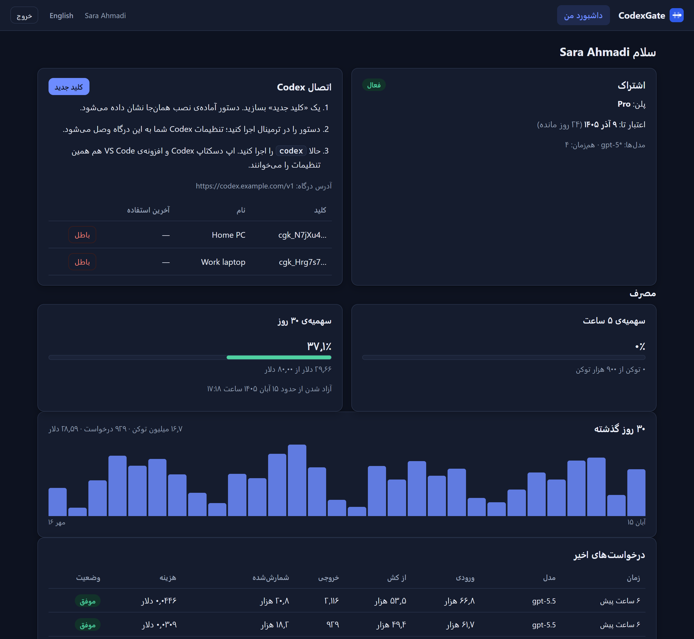
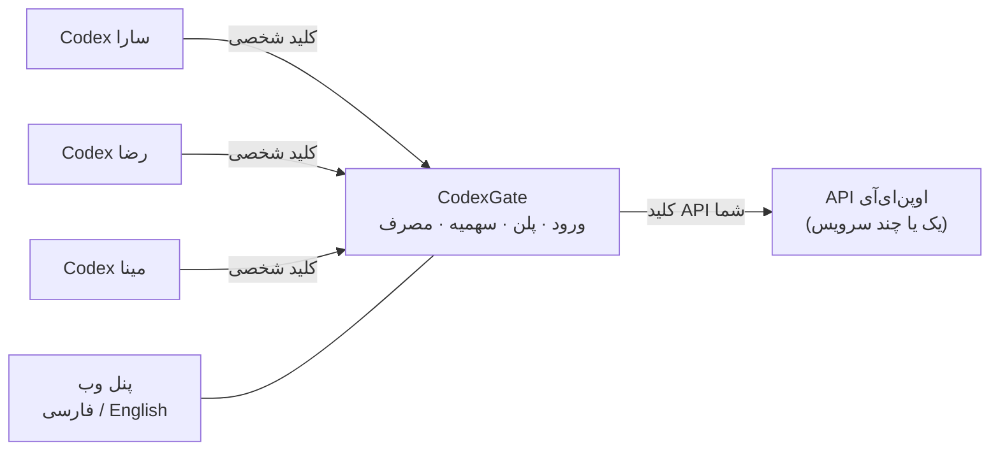
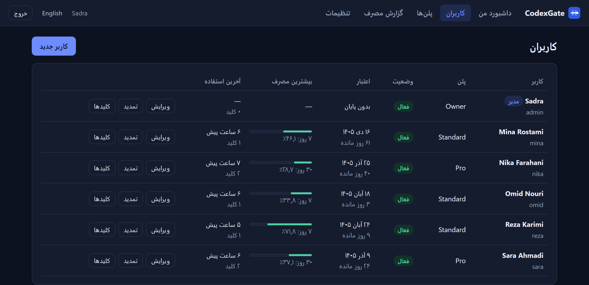
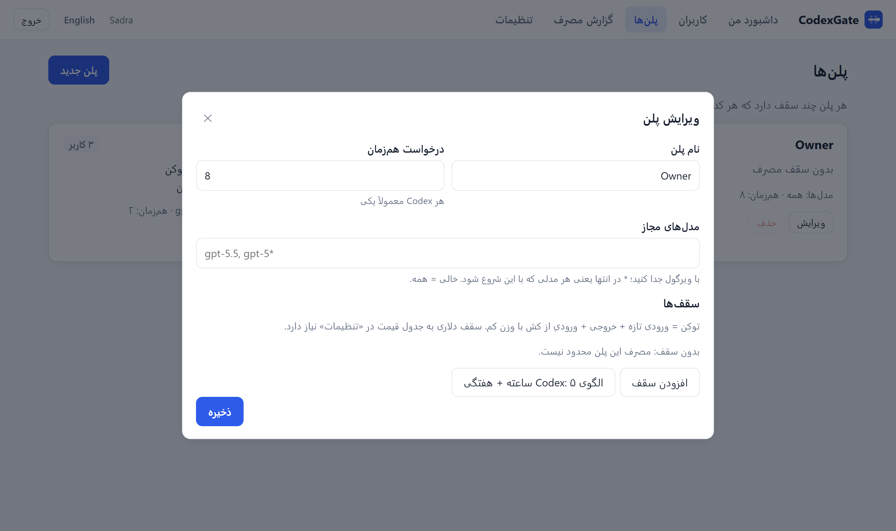
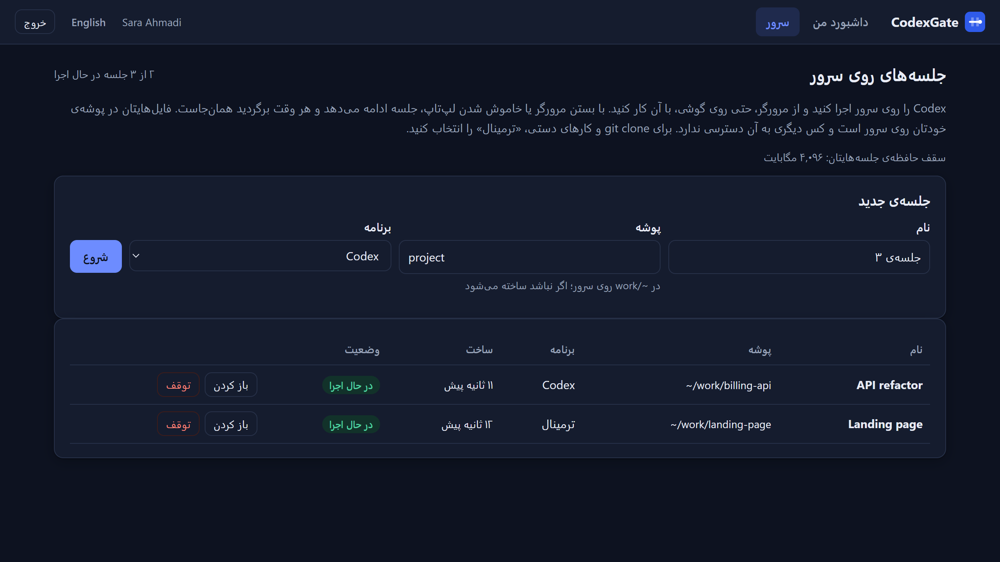
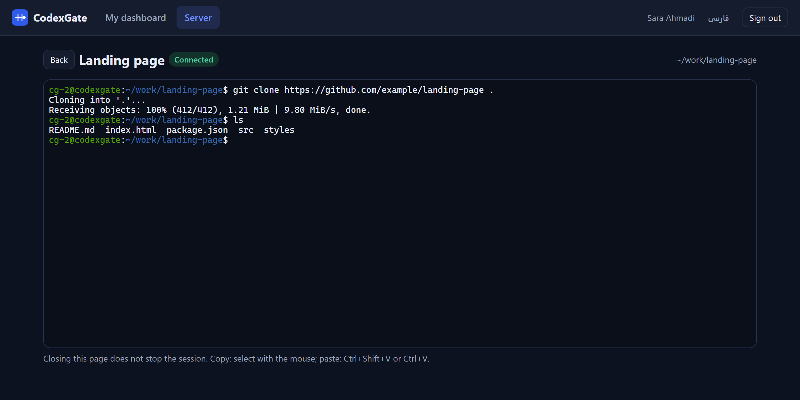

<div dir="rtl">

<p align="center">
  
</p>

<h1 align="center">CodexGate</h1>

<p align="center">
  <b>یک حساب API اوپن‌ای‌آی را با Codex هم‌تیمی‌هایتان شریک شوید؛ هر نفر با نام کاربری، سهمیه و تاریخ پایان خودش.</b>
</p>

<p align="center">
  <a href="https://github.com/sadrazkh/CodexGate/actions/workflows/ci.yml"></a>
  
  
  
  <a href="LICENSE"></a>
</p>

<p align="center">
  <a href="README.md">English</a> · <b>فارسی</b>
</p>

<p align="center">
  
</p>

---

## چرا

Codex عالی است و کلید API راه درست پرداختش است. ولی اگر یک کلید را به پنج نفر بدهید، کسی نمی‌داند چه کسی چقدر مصرف کرده، نمی‌شود کسی را سر بودجه‌اش نگه داشت، و برای قطع دسترسی یک نفر باید کلید همه را عوض کنید.

**CodexGate بین Codex تیم شما و API اوپن‌ای‌آی می‌نشیند.** هر هم‌تیمی نام کاربری، رمز، پلن و کلیدهای شخصی خودش را دارد و مثل قبل با Codex کار می‌کند (ترمینال، اپ دسکتاپ یا افزونه‌ی VS Code). هر درخواست از درگاه رد می‌شود: درگاه سهمیه را چک می‌کند، درخواست را با کلید *شما* می‌فرستد، جواب را دست‌نخورده برمی‌گرداند و مصرفش را ثبت می‌کند.



## امکانات

| | |
|---|---|
| **حساب‌ها** | نام کاربری و رمز، نقش مدیر یا کاربر، تاریخ پایان با تمدید یک‌کلیکی (۳۰ / ۹۰ / ۳۶۵ روز)، فعال و غیرفعال، یادداشت خصوصی. |
| **پلن‌ها** | هر تعداد سقف غلتان (۵ ساعته، روزانه، هفتگی، ماهانه یا دلخواه) به **توکن یا دلار**، مدل‌های مجاز (`gpt-5.5`، `gpt-5*`)، تعداد درخواست هم‌زمان. |
| **کلید شخصی** | هر کاربر کلید خودش را می‌سازد و باطل می‌کند. کلید فقط یک بار نشان داده می‌شود و فقط هش آن ذخیره می‌شود. |
| **Codex روی سرور** | اختیاری: Codex یا یک shell را روی سرور اجرا کنید و از ترمینال داخل مرورگر، حتی روی گوشی، با آن کار کنید. جلسه با بستن مرورگر یا خوابیدن لپ‌تاپ نمی‌میرد، با حساب سیستمی جدای هر هم‌تیمی اجرا می‌شود و از همان سهمیه کم می‌کند. [توضیح کامل](docs/remote.fa.md). |
| **نصب با یک دستور** | دستور آماده برای PowerShell و مک/لینوکس که `~/.codex/config.toml` را می‌نویسد (نسخه‌ی قبلی با پسوند `.bak` می‌ماند) و کلید را در `~/.codex/.env` می‌گذارد. با Codex واقعی آزموده شده. |
| **سقفی که Codex می‌فهمد** | وقتی سهمیه تمام شود، Codex همان لحظه می‌ایستد و می‌گوید *«You’ve hit your usage limit. Try again at 10:05 AM.»* |
| **مصرف و هزینه** | هر درخواست با توکن ورودی، از کش، خروجی و هزینه؛ نمودار ۳۰ روزه؛ جمع به تفکیک کاربر و مدل؛ خروجی CSV؛ صفر کردن سهمیه‌ی یک کاربر بدون پاک شدن سابقه. |
| **چند سرویس مدل** | هر درخواست به کم‌کارترین سرویسی می‌رود که آن مدل را دارد، و اگر یکی 429 یا 5xx داد یا در دسترس نبود، خودکار سراغ بعدی می‌رود. |
| **امن از پایه** | کلید اصلی و مشخصات سازمان شما به کاربرها نمی‌رسد. هر درخواست پیش از رفتن چک و بازنویسی می‌شود: ذخیره سمت سرور خاموش، شناسه‌ی جدا برای هر کاربر، و هیچ امکانی که شمارش نشود. CSP سخت‌گیر، محافظت CSRF، محدودیت تلاش ورود، و بسته شدن نشست‌ها وقتی کاربر غیرفعال شود یا رمزش عوض شود. |
| **جست‌وجوی وب زیر کنترل** | Codex همراه هر درخواست ابزار جست‌وجوی وب را می‌فرستد و API برای هر جست‌وجو پول جدا می‌گیرد. تا اجازه ندهید حذف می‌شود؛ اگر اجازه دهید، هر جست‌وجو شمرده و قیمت‌گذاری می‌شود. |
| **پشتیبان** | یک کلیک، یک نسخه‌ی سالم از کل دیتابیس. |
| **پنل فارسی و انگلیسی** | راست‌به‌چپ با تقویم شمسی یا چپ‌به‌راست با تقویم میلادی، روشن و تیره، روی گوشی هم. |

<table>
  <tr>
    <td></td>
    <td></td>
  </tr>
  <tr>
    <td align="center"><sub>کاربران در یک نگاه</sub></td>
    <td align="center"><sub>ویرایش پلن</sub></td>
  </tr>
  <tr>
    <td></td>
    <td></td>
  </tr>
  <tr>
    <td align="center"><sub>جلسه‌های روی سرور</sub></td>
    <td align="center"><sub>Codex روی سرور، داخل مرورگر</sub></td>
  </tr>
</table>

## راه‌اندازی سریع

### روی سرور لینوکس با یک دستور

<div dir="ltr">

```bash
bash <(curl -fsSL https://raw.githubusercontent.com/sadrazkh/CodexGate/main/install.sh)
```

</div>

نصب‌کننده اگر لازم باشد Docker را نصب می‌کند، CodexGate را (همراه جلسه‌های سرور) می‌سازد و بالا می‌آورد و **فقط از پورت‌های آزاد** استفاده می‌کند. اگر x-ui یا یک وب‌سرور پورت 443 یا 80 را گرفته باشد، به آن دست نمی‌زند. در آخر یک لینک خصوصی به صفحه‌ی نصب چاپ می‌کند که در آن:

۱. نام کاربری و رمز مدیر را انتخاب می‌کنید؛

۲. دامنه را می‌دهید (قبلش رکورد A آن را به IP سرور اشاره دهید)؛

۳. روش گرفتن گواهی Let's Encrypt را انتخاب می‌کنید: **پورت 80** اگر آزاد بوده، یا **DNS در Cloudflare** با یک API Token که هیچ پورتی لازم ندارد؛

۴. اگر خواستید کلید OpenAI را می‌گذارید (بعداً هم در «تنظیمات» می‌شود).

گواهی گرفته می‌شود، پنل روی `https://دامنه:8443` می‌رود و صفحه‌ی نصب بسته می‌شود. گواهی خودش تمدید می‌شود. برای به‌روزرسانی همان دستور را دوباره اجرا کنید؛ داده‌ها می‌ماند. گزینه‌ها: `--https-port 443` (اگر آزاد است)، `--setup-port N`، `--memory 16g` (پیش‌فرض: ۶۰٪ رم سرور).

### دستی با Docker

<div dir="ltr">

```bash
docker build -t codexgate .
docker run -d --name codexgate --restart unless-stopped \
  -p 127.0.0.1:8080:8080 -v codexgate-data:/data \
  -e Gate__Upstreams__0__BaseUrl=https://api.openai.com/v1 \
  -e Gate__Upstreams__0__ApiKey=sk-... \
  codexgate
```

</div>

یا فایل [`docker-compose.example.yml`](docker-compose.example.yml) را به `docker-compose.yml` کپی کنید و `docker compose up -d` بزنید.

اگر **Codex روی سرور** را هم می‌خواهید، به‌جای آن image نسخه‌ی `remote` را بسازید (`docker build -t codexgate-remote --target remote .`) و `/home` را روی volume نگه دارید. جزئیات و راه‌اندازی روی لینوکس بدون Docker در [docs/remote.fa.md](docs/remote.fa.md) است.

> [!IMPORTANT]
> CodexGate را پشت HTTPS بگذارید (Caddy، nginx، Cloudflare Tunnel و…). کلید و رمز نباید روی HTTP ساده جابه‌جا شوند. پشت پروکسی خودتان `Gate__TrustForwardedHeaders=true` را هم بگذارید.

### از سورس

به [.NET 10 SDK](https://dotnet.microsoft.com/download) نیاز دارد.

<div dir="ltr">

```bash
dotnet run --project src/CodexGate -- --urls http://127.0.0.1:8080 \
  --Gate:Upstreams:0:BaseUrl=https://api.openai.com/v1 --Gate:Upstreams:0:ApiKey=sk-...
```

</div>

### قدم‌های اول

۱. **ورود.** اگر `Gate__AdminPassword` را نگذاشته باشید، بار اول یک رمز تصادفی برای مدیر در فایل `initial-admin-password.txt` داخل پوشه‌ی داده نوشته می‌شود (نه در لاگ). رمز را عوض کنید و فایل را پاک کنید.

۲. **تنظیمات:** آدرس عمومی (مثلاً `https://codex.example.com`)، مدل پیش‌فرض و قیمت مدل‌ها (دلار برای هر یک میلیون توکن؛ برای سقف دلاری و ستون هزینه لازم است).

۳. **پلن‌ها ← پلن جدید.** دکمه‌ی «الگوی Codex» یک سقف ۵ ساعته و یک سقف هفتگی می‌گذارد.

۴. **کاربران ← کاربر جدید.** پنل یک پیام آماده با آدرس، نام کاربری و رمز می‌دهد که برای هم‌تیمی‌تان بفرستید.

۵. هم‌تیمی وارد می‌شود، «کلید جدید» را می‌زند، دستور را در ترمینال اجرا می‌کند و بعد `codex` را می‌زند.

## تنظیمات

هر تنظیم یک متغیر محیطی (`Gate__Name`) یا یک آرگومان خط فرمان (`--Gate:Name=`) است.

| تنظیم | پیش‌فرض | توضیح |
|---|---|---|
| `Gate__Upstreams__N__BaseUrl` | — | یک Responses API سازگار با اوپن‌ای‌آی، مثل `https://api.openai.com/v1`. `N` یعنی ۰، ۱، ۲… |
| `Gate__Upstreams__N__ApiKey` | — | کلید آن. فقط خود درگاه آن را می‌بیند. |
| `Gate__Upstreams__N__Name` | `upstream-N` | نامی که در گزارش دیده می‌شود. |
| `Gate__Upstreams__N__Models__0` | همه | الگوی مدل‌هایی که این سرویس دارد. |
| `Gate__DataDir` | `codexgate-data` و در Docker `/data` | دیتابیس، کلیدهای کوکی و رمز اول. از آن پشتیبان بگیرید. |
| `Gate__AdminUsername` / `Gate__AdminPassword` | `admin` / تصادفی | فقط وقتی هنوز مدیری وجود ندارد استفاده می‌شود. |
| `Gate__TrustForwardedHeaders` | `false` | پشت پروکسی خودتان روشن کنید (IP واقعی کاربر و کوکی امن). |
| `Gate__TrustedProxies__0` | همه | آدرس یا رنج CIDR پروکسی؛ بگذاریدش، مگر این‌که پورت درگاه جز از راه پروکسی در دسترس نباشد. |
| `Gate__MaxConcurrentRequests` | `64` | کل درخواست‌های هم‌زمان همه‌ی کاربرها؛ بیشتر از این «مشغول» می‌گیرد تا حافظه محدود بماند. |
| `Gate__DrainSecondsAfterAbort` | `15` | وقتی Codex جوابی را قطع می‌کند، درگاه این‌قدر ادامه می‌خواند تا مصرف واقعی برسد. |
| `Gate__CachedTokenWeight` | `0.1` | هر توکن ورودیِ از کش چقدر از سقف توکنی کم کند. |
| `Gate__MaxRequestBodyMb` | `32` | بزرگ‌ترین درخواستی که Codex می‌تواند بفرستد. |
| `Gate__Remote__Enabled` | `false` و در image ریموت `true` | جلسه‌های Codex روی همین سرور ([docs/remote.fa.md](docs/remote.fa.md)). |
| `Gate__Remote__GatewayUrl` | `http://127.0.0.1:8080/v1` | آدرسی که Codex داخل جلسه‌ی سرور با آن به همین درگاه می‌رسد. |

## سهمیه چطور شمرده می‌شود

- هر سقف، مصرف **N ساعت گذشته** را می‌شمارد (پنجره‌ی غلتان) و با قدیمی شدن مصرف، دوباره جا باز می‌شود.
- **توکن** = ورودی تازه + خروجی + ورودیِ از کش × `CachedTokenWeight`. Codex در هر نوبت کل گفتگو را دوباره می‌فرستد و بیشترش از کش می‌آید که حدود یک‌دهم قیمت دارد.
- **دلار** از جدول قیمت حساب می‌شود. پلنی که سقف دلاری دارد، مدل بدون قیمت را قبول نمی‌کند.
- چک قبل از فرستادن درخواست انجام می‌شود، پس یک درخواست ممکن است کمی از سقف رد شود.
- درخواست‌هایی که هنوز در جریان‌اند هم با میانگین مصرف اخیر کاربر حساب می‌شوند، تا چند درخواست هم‌زمان نتوانند از سقفِ تقریباً پر رد شوند.
- اگر Codex وسط جواب قطع کند (Esc)، درگاه چند ثانیه دیگر می‌خواند تا گزارش واقعی مصرف برسد. اگر جواب در این مدت تمام نشود، تخمین ثبت می‌شود و «تخمینی» علامت می‌خورد.

## نکته‌ها

- **کلید API، نه اشتراک ChatGPT.** شریک کردن لاگین Plus/Pro/Business یک نفر بین چند نفر خلاف قوانین اوپن‌ای‌آی است و حساب را به خطر می‌اندازد. برای اشتراک، به هر نفر صندلی خودش را بدهید.
- فقط آنچه Codex لازم دارد رد می‌شود: `/v1/responses` به‌صورت جریانی و `/v1/models`. حالت پس‌زمینه، سرعت ویژه، گفتگوهای ذخیره‌شده روی سرور (`previous_response_id`، `conversation`، `prompt`) و ابزارهای پولی به‌جز جست‌وجوی وبِ مجاز، رد یا حذف می‌شوند، چون درگاه نمی‌تواند مصرفشان را بشمارد.
- «درخواست هم‌زمان» در حافظه شمرده می‌شود، پس فقط یک نمونه از برنامه را اجرا کنید.

## توسعه

<div dir="ltr">

```bash
dotnet test                         # 118 unit and integration tests (fake upstream, fake session host), no network
node tools/mock-upstream.mjs 5191   # a stand-in Responses API to try the whole flow for free
```

</div>

## مجوز

[GNU AGPL-3.0](LICENSE). استفاده، تغییر و انتشار CodexGate آزاد است؛ اگر نسخه‌ی تغییریافته را به‌صورت سرویس برای دیگران اجرا کنید، باید کد آن را هم در اختیارشان بگذارید.

</div>
