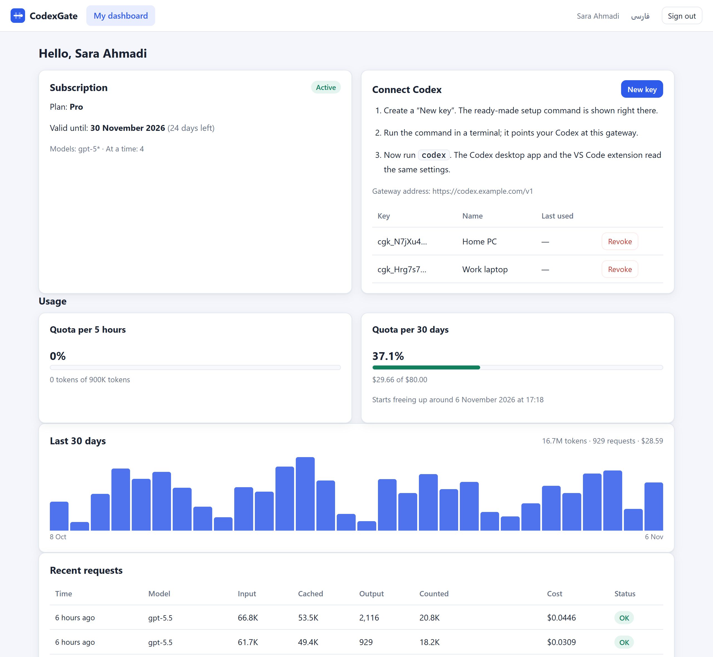
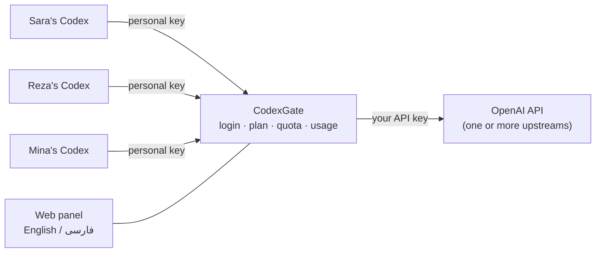
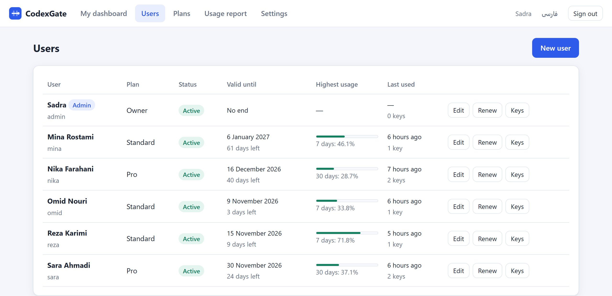
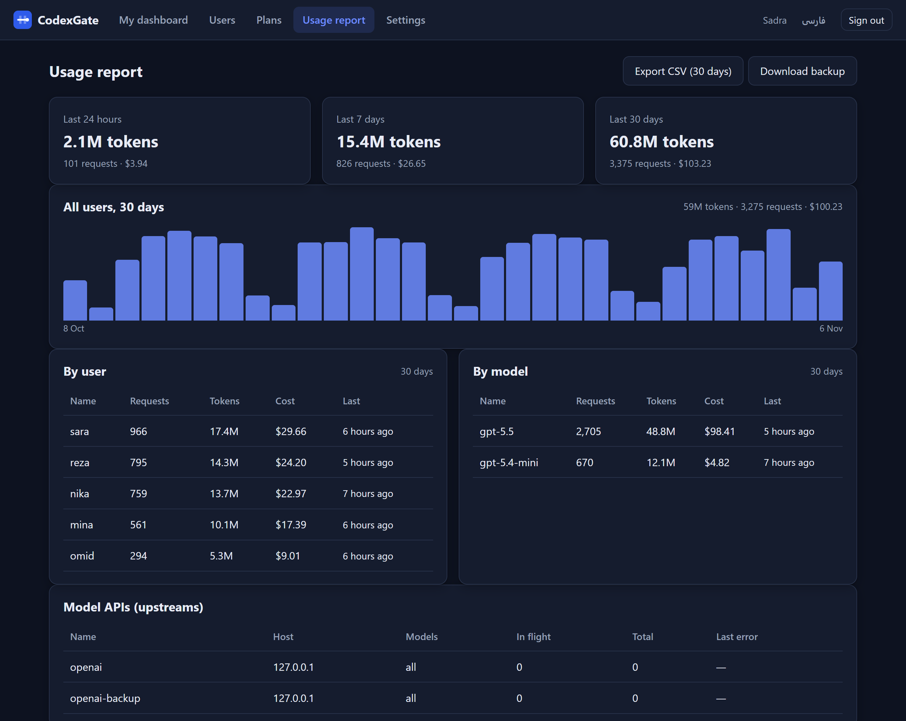
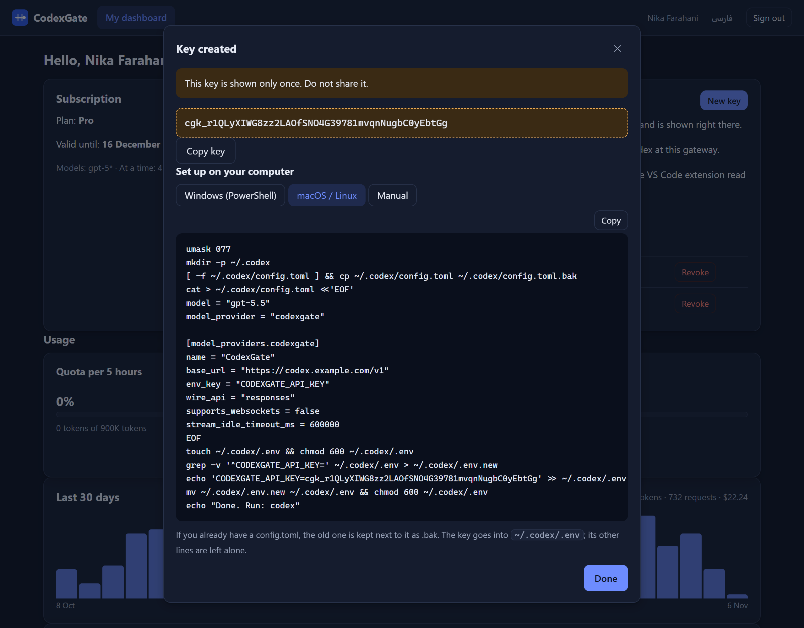
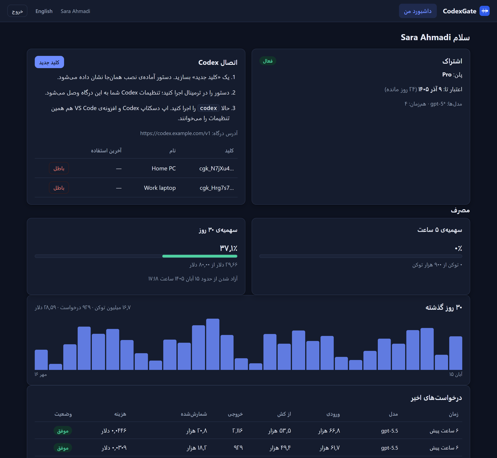

<p align="center">
  
</p>

<h1 align="center">CodexGate</h1>

<p align="center">
  <b>Share one OpenAI API account with your team’s Codex, with a login, a quota and an end date for every teammate.</b>
</p>

<p align="center">
  <a href="https://github.com/sadrazkh/CodexGate/actions/workflows/ci.yml"></a>
  
  
  
  <a href="LICENSE"></a>
  
</p>

<p align="center">
  <b>English</b> · <a href="README.fa.md">فارسی</a>
</p>

<p align="center">
  
</p>

---

## Why

Codex is great, and an API key is the clean way to pay for it. But handing the same key to five
people means no one knows who used what, nobody can be stopped at a budget, and revoking one
person means rotating the key for everyone.

**CodexGate sits between your team’s Codex and the OpenAI API.** Each teammate gets their own
username, password, plan and personal keys. They keep using Codex exactly as before (CLI,
desktop app or VS Code extension); every request passes through the gateway, which checks
their quota, forwards it with *your* key, streams the answer back untouched and records what it
cost.



## Features

| | |
|---|---|
| **Accounts** | Username and password, admin or user, an end date with one-click renewal (+30 / +90 / +365 days), enable / disable, private notes. |
| **Plans** | Any number of rolling limits (5 hours, 1 day, 7 days, 30 days or custom) in **tokens or dollars**, allowed models (`gpt-5.5`, `gpt-5*`), requests at a time. |
| **Personal keys** | Users create and revoke their own keys; shown once, stored only as a hash, with “last used”. |
| **One-command setup** | Ready-made PowerShell and macOS/Linux commands write `~/.codex/config.toml` (old one kept as `.bak`) and put the key in `~/.codex/.env`. Tested against the real Codex CLI. |
| **Limits Codex understands** | When a limit is hit, Codex stops at once with *“You’ve hit your usage limit. Try again at 10:05 AM.”* |
| **Usage and cost** | Every request with input, cached and output tokens and its cost; 30-day charts; totals by user and model; CSV export; a reset that starts a user’s quotas over and keeps history. |
| **Several upstreams** | Least-busy routing per model and automatic failover on 429 / 5xx / network errors. |
| **Safe by default** | Upstream key and organization never reach users, requests are checked and rewritten before they leave (no server-side storage, a per-user safety id, no unmetered features), strict CSP, CSRF header, login throttling, sessions end when a user is disabled or their password changes. |
| **Web search under control** | Codex asks for a web search tool on every request, and the API bills each search. It is removed unless you allow it; when allowed, every search is counted and priced. |
| **Backups** | One click downloads a consistent copy of the database. |
| **Panel in English and Persian** | Left-to-right with the Gregorian calendar or right-to-left with the Persian one, light and dark, works on a phone. |

<table>
  <tr>
    <td></td>
    <td></td>
  </tr>
  <tr>
    <td align="center"><sub>Users at a glance</sub></td>
    <td align="center"><sub>Usage report</sub></td>
  </tr>
  <tr>
    <td></td>
    <td></td>
  </tr>
  <tr>
    <td align="center"><sub>A new key with its setup command</sub></td>
    <td align="center"><sub>Persian, right-to-left, dark</sub></td>
  </tr>
</table>

## Quick start

### Docker

```bash
docker build -t codexgate .
docker run -d --name codexgate --restart unless-stopped \
  -p 127.0.0.1:8080:8080 -v codexgate-data:/data \
  -e Gate__Upstreams__0__BaseUrl=https://api.openai.com/v1 \
  -e Gate__Upstreams__0__ApiKey=sk-... \
  codexgate
```

Or copy [`docker-compose.example.yml`](docker-compose.example.yml) to `docker-compose.yml` and run `docker compose up -d`.

> [!IMPORTANT]
> Put CodexGate behind HTTPS (Caddy, nginx, Cloudflare Tunnel…). Keys and passwords must not travel
> over plain HTTP. Behind your own proxy, set `Gate__TrustForwardedHeaders=true`.

### From source

Requires the [.NET 10 SDK](https://dotnet.microsoft.com/download).

```bash
dotnet run --project src/CodexGate -- --urls http://127.0.0.1:8080 \
  --Gate:Upstreams:0:BaseUrl=https://api.openai.com/v1 --Gate:Upstreams:0:ApiKey=sk-...
```

### First steps

1. **Sign in.** Unless you set `Gate__AdminPassword`, the first start writes a random admin password to
   `<data folder>/initial-admin-password.txt` (never to the log). Change it, then delete the file.
2. **Settings:** the public address (e.g. `https://codex.example.com`), the default model and model
   prices (dollars per million tokens; needed for dollar limits and cost columns).
3. **Plans → New plan.** “Codex-style” fills in a 5-hour and a weekly limit.
4. **Users → New user.** The panel gives you a ready message with the address, username and password.
5. Your teammate signs in, clicks **New key**, pastes the command into a terminal and runs `codex`.

## Configuration

Every setting is an environment variable (`Gate__Name`) or a command-line flag (`--Gate:Name=`).

| Setting | Default | |
|---|---|---|
| `Gate__Upstreams__N__BaseUrl` | — | An OpenAI-compatible Responses API, e.g. `https://api.openai.com/v1`. `N` = 0, 1, 2… |
| `Gate__Upstreams__N__ApiKey` | — | Its key. Only the gateway ever sees it. |
| `Gate__Upstreams__N__Name` | `upstream-N` | Shown in the report. |
| `Gate__Upstreams__N__Models__0` | every model | Model patterns this upstream serves. |
| `Gate__Upstreams__N__Headers__<Name>` | — | Extra headers, e.g. `OpenAI-Project`. |
| `Gate__DataDir` | `codexgate-data` · `/data` in Docker | Database, cookie keys and the first password. Back it up. |
| `Gate__AdminUsername` / `Gate__AdminPassword` | `admin` / generated | Used only while no admin exists. |
| `Gate__TrustForwardedHeaders` | `false` | Turn on behind your own reverse proxy (real client IPs, secure cookies). |
| `Gate__TrustedProxies__0` | anyone | The proxy’s address or CIDR range; set it unless the gateway’s port is unreachable except through the proxy. |
| `Gate__MaxConcurrentRequests` | `64` | Requests in flight across everyone; more get “busy” so memory stays bounded. |
| `Gate__DrainSecondsAfterAbort` | `15` | After Codex stops an answer, keep reading this long so the real usage still arrives. |
| `Gate__CachedTokenWeight` | `0.1` | How much a cached input token counts against token limits. |
| `Gate__MaxRequestBodyMb` | `32` | Largest request Codex may send. |

## How limits count

- Each limit counts what the user used in the **last N hours** (a rolling window); room frees up as old usage ages out.
- **Tokens** = fresh input + output + cached input × `CachedTokenWeight`. Codex resends the whole conversation every
  turn and most of it is cached, which the API bills at about a tenth.
- **Dollars** use the price table. A plan with a dollar limit refuses models that have no price.
- The check runs before a request is sent, so a single request can finish slightly over a limit.
- Requests already running count at the user’s recent average, so parallel requests cannot all slip in under a nearly full limit.
- When Codex interrupts an answer (Esc), the gateway keeps reading for a few seconds to catch the real usage report. If the
  answer does not finish in that time, it records an estimate and marks it *estimated*.

## Good to know

- **API keys, not ChatGPT subscriptions.** Sharing one person’s Plus/Pro/Business login between several people breaks
  OpenAI’s terms and gets accounts banned. For subscriptions, give each person their own seat.
- Only what Codex needs gets through: streamed `/v1/responses` and `/v1/models`. Background mode, priority/fast tiers,
  server-stored conversations (`previous_response_id`, `conversation`, `prompt`) and billed hosted tools other than an
  allowed web search are refused or removed, because the gateway could not meter them.
- “Requests at a time” is counted in memory, so run a single instance.
- Teammates run Codex on their own machines. Running Codex sessions on the server is not part of this project yet.

## Development

```bash
dotnet test                         # 100 unit and integration tests against a fake upstream, no network
node tools/mock-upstream.mjs 5191   # a stand-in Responses API to try the whole flow without spending anything
```

The stack is deliberately small: ASP.NET Core minimal APIs, Dapper on SQLite, and a dependency-free
JavaScript panel with no build step.

## License

[GNU AGPL-3.0](LICENSE). You may use, change and share CodexGate; if you run a changed version as a service for
others, you must offer them its source code.
